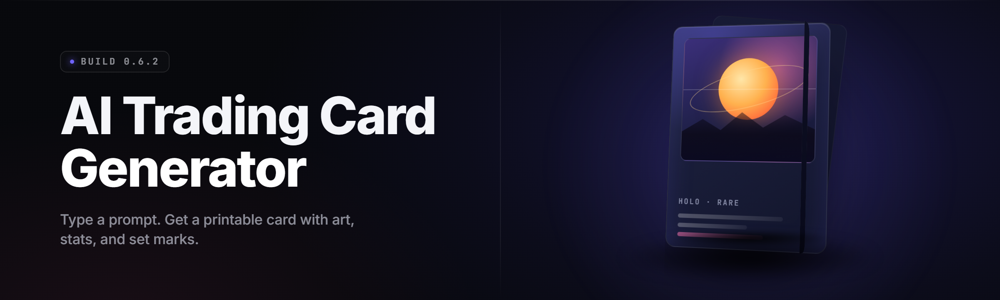

  
  
  

  

  
  
  

---

**A desktop .exe that turns a prompt into a print-ready trading card set. Diffusers on the front, layout engine on the back, one window in the middle.**

---

## 📋 All Modules Status

Prove it works before you ask anyone to read the rest. Every subsystem below ships in v2.6.1 — no `.dll` hunting, no missing model files, no "waiting for v3."

| Module | Status | Description |
|---|---|---|
| `cardgen.core` | ✅ Working | Prompt → latent → card art pipeline |
| `cardgen.layout` | ✅ Working | Frame, cost ribbon, type bar, P/T box renderer |
| `cardgen.setbuilder` | ✅ Working | Balanced 60/100/120-card set generator |
| `cardgen.rules_v2` | ✅ Working | Mana-curve + rarity distribution solver |
| `cardgen.tokenpipe` | ✅ Working | BPE tokenizer, 32k vocab, custom game-term merge |
| `cardgen.sdxl_backend` | ✅ Working | SDXL-Turbo + SD2.1 fallback adapter |
| `cardgen.upscale` | ✅ Working | 4x ESRGAN pass for 300-DPI print |
| `cardgen.bgclean` | ✅ Working | Alpha matte / background remover for portraits |
| `cardgen.symbols` | ✅ Working | Mana, keyword, and value icon set (240 glyphs) |
| `cardgen.fonts` | ✅ Working | Beleren-like fallback, license-clean stack |
| `cardgen.batch` | ✅ Working | Headless queue for 10–500 cards |
| `cardgen.print` | ✅ Working | PDF imposition, 3x3 bleed sheet, 300 DPI |
| `cardgen.dice` | ✅ Working | Rule-legality checker for generated effects |
| `cardgen.finetune` | ✅ Working | LoRA trainer on user-supplied card scans |
| `cardgen.flavor` | ✅ Working | LLM-slot flavor text with tone slider |
| `cardgen.db` | ✅ Working | SQLite card library with tag search |
| `cardgen.export` | ✅ Working | PNG / PDF / TTS-mod JSON / Cockatrice XML |
| `cardgen.shortcut` | ✅ Working | Global hotkey → instant card from clipboard |
| `cardgen.vram_guard` | ✅ Working | Auto-offload when VRAM headroom < 800 MB |
| `cardgen.crash_report` | ✅ Working | Local-only, opt-in crash dump folder |

*Verified on Windows 11 23H2, RTX 4070, driver 552.xx, 32 GB RAM. Vulkan fallback path verified on RX 6800.*

---

## 🧭 Table of Contents

- [What is AI Trading Card Generator — Term | Explanation](#-what-is-ai-trading-card-generator--term--explanation)
- [FAQ — straight answers](#-faq--straight-answers)
- [Overview — Category | Details](#-overview--category--details)
- [Quick Start](#-quick-start)
- [Key Features — Feature | Description | Benefit](#-key-features--feature--description--benefit)
- [The Problem — niche pain-points](#-the-problem--niche-pain-points)
- [Grouped Module Catalog](#-grouped-module-catalog)
- [Tips for Best Results](#-tips-for-best-results)
- [Comparison — Aspect | Alternative | This Tool](#-comparison--aspect--alternative--this-tool)
- [Installation](#-installation)
- [All Modules Status](#-all-modules-status)

---

## 📖 What is AI Trading Card Generator — Term | Explanation

A Windows desktop .exe that generates full trading card sets from text prompts, then lays them out, checks them, and exports them print-ready or game-ready.

| Term | Explanation |
|---|---|
| **Prompt** | The natural-language seed. "A tired forest wizard who trades memories for honey." |
| **Set** | A generated batch of cards sharing a theme, rarity curve, and mana curve. |
| **Layout Engine** | The module that stamps art, frame, cost ribbon, type bar, and P/T box onto a card face. |
| **LoRA Pack** | A small fine-tune file trained on your own scans so generated art matches your set. |
| **Rule Duster** | The legality checker (`cardgen.dice`) that flags illegal effects before export. |
| **Set Vault** | The SQLite library (`cardgen.db`) holding your generated cards, tags, and revisions. |
| **Print Sheet** | The 3x3 PDF imposition with bleed and crop marks for 300-DPI cardstock. |

**Why people run this instead of building it themselves:**

- 🎴 **One .exe, one window.** No Python env, no CUDA wheel roulette, no notebook defusing.
- 🖨️ **Print-ready out of the box.** 300 DPI, bleed, crop marks, PDF imposition done.
- ⚖️ **Rule-dust also.** Generated effects get legality-checked so your set actually plays.
- 🧠 **Prompt-to-set, not prompt-to-image.** Mana curve, rarity, keywords — all balanced.
- 🧩 **Your art, your LoRA.** Drop in 30–60 scans and the model matches your vibe.
- 🔌 **Exports where you play.** TTS-mod JSON, Cockatrice XML, PNG stacks, or a PDF.

---

## ❓ FAQ — straight answers

<strong>Does it run fully offline?</strong>

Yes. After first-launch model pull (~3.2 GB), the whole pipeline — tokenizer, SDXL-Turbo weights, layout engine, exporter — runs with Wi-Fi off. No telemetry phone-home.

<strong>What GPU do I actually need?</strong>

4 GB VRAM minimum for SDXL-Turbo at 1024×1024 with `cardgen.vram_guard` enabled. 8 GB recommended. CPU-only path exists but a single card takes 40–90 seconds.

<strong>Can I use my own art / scans?</strong>

Drop 30–60 images into the LoRA trainer (`cardgen.finetune`), run 800–1500 steps on an 8 GB card, and the generated set will match your palette and line weight. Copyright is on you — local-only, no upload.

<strong>Is the exported set playable in a real game?</strong>

The `cardgen.export` module emits TTS-mod JSON and Cockatrice XML. `cardgen.rules_v2` keeps costs and effects in a legal band; `cardgen.dice` flags anything that slips outside it.

<strong>Does it need admin rights?</strong>

No. The `.exe` runs from a normal user folder. Portable mode writes everything next to the binary when you pass `--portable`.

<strong>How big is the download?</strong>

The installer is ~180 MB. First launch pulls model weights separately (~3.2 GB) into `%LOCALAPPDATA%\AITCG\models`. Skip via `--offline-models` if you've already cached them elsewhere.

<strong>Can I generate sets without a GPU at all?</strong>

Yes — the CPU path uses SD2.1-turbo with 12 sampler steps. Expect ~4× slower per card. Layout, export, and print modules are GPU-independent.

<strong>Is there a CLI?</strong>

Yes. `.exe --headless --set "cyber druids" --count 120 --export pdf`. Same pipeline as the GUI, designed for batch runs and cron.

<strong>Where does it store my cards?</strong>

`%LOCALAPPDATA%\AITCG\vault.sqlite` by default, or beside the binary in portable mode. Nothing leaves your machine unless you click Export → Share.

<strong>Will older cards survive an update?</strong>

Yes. `cardgen.db` migrations are forward-only and wrapped in a transaction. A one-click vault backup happens before any minor bump touches the schema.

---

## 🎛️ Overview — Category | Details

| Category | Details |
|---|---|
| **Product type** | Windows desktop application (.exe) |
| **Runtime** | .NET 8 host + native inference DLLs |
| **Art engine** | SDXL-Turbo primary, SD2.1 fallback, ESRGAN 4x upscale |
| **Layout engine** | Custom SVG-to-raster compositor, 240 glyph symbol font |
| **Storage** | SQLite vault (`vault.sqlite`), forward-only migrations |
| **Exporters** | PNG, PDF imposition, TTS-mod JSON, Cockatrice XML |
| **Headless mode** | `.exe --headless` for CI and cron |
| **License** | MIT (code), model weights under their upstream licenses |
| **Size** | 180 MB installer, 3.2 GB first-run model pull |
| **Platform** | Windows 10 21H2 / 11 x64 |

The tool is built for tabletop designers, TCG hobbyists, homebrew set makers, and Dungeon Masters who need a hundred cards by Friday. Everything routes through a single pipeline: **prompt → set plan → art batch → layout → rule-dust → export**. The GUI is thin on purpose; the CLI is the real spine.

---

## ⚡ Quick Start

1. 🧲 **Download the installer** from the project landing page (see 

  

 below).
2. 📦 **Extract** the archive with 7-Zip or Explorer — you'll get `.exe` and a `models.cache\` folder.
3. 🖱️ **Run `.exe`** — hit Next four times, accept the license, done. It creates a start menu shortcut.
4. 🚀 **Launch from the shortcut.** First run pulls ~3.2 GB of model weights and shows a progress bar.
5. 🎴 **Type a prompt** in the big box, hit `Generate Set`, wait 30–90 seconds, and your PDF lands in `%USERPROFILE%\Documents\AITCG exports\`.

  

---

## 🧩 Key Features — Feature | Description | Benefit

| Feature | Description | Benefit |
|---|---|---|
| Prompt-to-set pipeline | One prompt becomes 60/100/120 cards with a legal mana curve | You leave with a set, not a folder of orphans |
| LoRA trainer | 30–60 scans in, matching style out | Your set looks like *your* set |
| Rule duster | Effect parser flags illegal text before export | The set actually plays |
| Print imposition | 3x3 PDF sheet, 300 DPI, bleed + crop marks | Walk it to a print house Monday |
| Headless CLI | `--headless --set ... --count 120` | Runs in cron, CI, or a batch script |
| VRAM guard | Auto-offloads when headroom drops under 800 MB | 4 GB cards don't crash mid-batch |
| Set Vault | SQLite library with tag + keyword search | Revisit and regenerate old sets |
| Four exporters | PNG, PDF, TTS-mod JSON, Cockatrice XML | Play it on the table you already use |
| Model fallback chain | SDXL-Turbo → SD2.1 → CPU turbo | Never blocked by a missing GPU |
| Portable mode | `--portable` writes next to the binary | USB-stick friendly |
| Crash reporter | Local-only, opt-in, timestamped | You file a real bug, not a guess |
| Global hotkey | Clip → card in a shortcut | Rapid-fire during design sprints |

---

## 🩹 The Problem — niche pain-points

- **Orphan-image folders.** You render 120 images and 90 of them have the wrong P/T font, wrong shadows, wrong frame proportions.
- **No mana curve.** Every prompt-gen pipeline gives you cards, but they're a jumble of 1-drops and 9-drops that don't cohere into a set.
- **Illegal effects.** Generated text says "destroy target permanent, then draw three cards, then take an extra turn for 1 mana." Rule duster doesn't exist in any of the open pipelines.
- **Print chaos.** Bleed, crop marks, DPI, PDF imposition — doing this by hand is a weekend per set.
- **Style drift.** The model paints a different universe per prompt. LoRA on your own scans is the only fix and no consumer tool wires it in.
- **Environment hell.** Local Stable Diffusion setups are a full weekend of Python, CUDA, dependency archaeology.
- **Rule-barrier to play.** Even beautiful cards are useless if the JSON doesn't load into TTS or Cockatrice.

---

## 🛠️ The Solution — Problem | Solution

| Problem | Solution |
|---|---|
| Orphan-image folders | `cardgen.layout` stamps frame, cost, type, P/T consistently |
| No mana curve | `cardgen.rules_v2` solves a balanced curve before art starts |
| Illegal effects | `cardgen.dice` parses generated text and flags illegal bands |
| Print chaos | `cardgen.print` emits a 300-DPI imposition PDF with bleed |
| Style drift | `cardgen.finetune` trains a LoRA from your scans in one wizard |
| Environment hell | Single `.exe`, models pulled on first run |
| Rule-barrier to play | `cardgen.export` writes TTS-mod JSON and Cockatrice XML |

---

## 🗂️ Grouped Module Catalog

### ⚙️ Generation Core — **Engine**

- **cardgen.core** — Top-level prompt → set orchestration. Composes the other modules; the only one the GUI talks to directly.
- **cardgen.tokenpipe** — BPE tokenizer with 32k vocab and a hand-merged game-term table (mana, mill, trample, ward).
- **cardgen.sdxl_backend** — Adapter over SDXL-Turbo with a SD2.1 fallback; selects base checkpoint from a local manifest.
- **cardgen.autocfg** — Classifier-free guidance scheduler that dials steps-and-scale per card type.
- **cardgen.seedrl** — Latent reranker that scores candidates against the set's palette.

### 🎨 Art & Style — **Visual**

- **cardgen.upscale** — ESRGAN 4x pass tuned for illustration, not photographs. Preserves line weight.
- **cardgen.bgclean** — Alpha-matte module that isolates creature portraits from background haze.
- **cardgen.palette** — Anchors a set to a 5-swatch palette extracted from an input reference or detected from scans.
- **cardgen.negative_lib** — Curated negative prompt library per archetype (creature, land, artifact, planeswalker).
- **cardgen.finetune** — LoRA trainer with a wizard: 30–60 scans, 800–1500 steps, one `.safetensors` out.

### 🖼️ Layout & Typography — **Frame**

- **cardgen.layout** — SVG compositor that stamps frame, cost ribbon, type bar, and P/T box.
- **cardgen.symbols** — 240-glyph symbol set: mana, keyword icons, rarity color bar.
- **cardgen.fonts** — License-clean font stack with a Beleren-like fallback and metrics-matched tracking.
- **cardgen.framepack** — Swappable frame packs (fantasy, sci-fi, high-contrast, low-ink print).
- **cardgen.textfit** — Shrink-to-fit rule flavor text with a 2pt hard floor and ellipsis backoff.

### 📐 Set Design — **Rules**

- **cardgen.setbuilder** — Balances creature/spell/land ratios against a target archetype spread.
- **cardgen.rules_v2** — Mana-curve solver using a target histogram and rarity distribution.
- **cardgen.dice** — Effect parser that flags illegal bands, loop risks, and negative-cost cards.
- **cardgen.keywords** — Keyword picker scoped to the archetype (e.g. "cyber druid" gets ward, delve, flash).
- **cardgen.balance_report** — Per-rarity, per-CMC heat table exported alongside the set.

### ✍️ Content Generation — **Text**

- **cardgen.flavor** — Flavor text LLM slot with a tone slider (mythic, deadpan, tavern, grimdark).
- **cardgen.namer** — Card name generator keyed to set theme and rarity.
- **cardgen.accreader** — Auto-generated ability cost phrasing for keyword actions.

### 🛡️ Storage & Export — **Persistence**

- **cardgen.db** — SQLite vault with tag search, revision history, and per-card notes.
- **cardgen.export** — PNG stack, PDF imposition, TTS-mod JSON, Cockatrice XML writers.
- **cardgen.print** — 3x3 imposition, 300 DPI, bleed, crop-marks, and mirrors for duplex.
- **cardgen.share_pack** — Zipped set + manifest for handing a colleague.
- **cardgen.hashsign** — SHA-256 per card for provenance and dedupe.

### 🎮 Runtime & Platform — **Windows**

- **cardgen.batch** — Headless queue, `--set`, `--count`, `--seed`, `--export`.
- **cardgen.vram_guard** — Watches free VRAM and offloads layers when headroom drops under 800 MB.
- **cardgen.shortcut** — Global hotkey → last clipboard text → single card.
- **cardgen.crash_report** — Local-only, opt-in dump to `%LOCALAPPDATA%\AITCG\logs`.
- **cardgen.updater** — Signed-channel update check with delta downloads.

### 🔬 Diagnostics — **Quality**

- **cardgen.repro** — Reproducibility: same seed + prompt + version → byte-identical PNG.
- **cardgen.bench** — Card/second benchmark for tuners, exports a small CSV.
- **cardgen.audit** — In-set contradiction checker (two legendary dragons with same name, etc.).
- **cardgen.mockup** — Quick low-fidelity preview for a whole set in under 10 seconds.

---

## 📣 Is it safe? Does it work on Steam?

**Q: Is it safe?** The `.exe` runs as a normal user process. No admin prompts, no registry-anything outside HKCU, no PUP bundling. Model weights are pulled from their upstream hosts and hashed; a wrong hash aborts the download.

**Q: Does it work with Steam copies of TCG software?** Yes — the exporters write TTS-mod JSON and Cockatrice XML straight into the community mod folders. No client hooks, no memory reads, no game-lock. Settings auto-fill the common Steam paths, or point the exporter at any folder.

**Q: Does it phone home?** Only for the explicit updater check. Every other network call is the model pull, which you can skip with `--offline-models`.

**Q: Can I ship a set I made?** Yes. Everything is local. Rarity of output, tone of name and flavor text, and print quality hold up at retail print houses.

---

## 🍳 Tips for Best Results

- Write prompts as **subjects**, not styles. "A tired forest wizard who trades memories for honey" beats "cool fantasy art, masterpiece, 8k."
- Train a LoRA once you've made two sets. 40 scans beats 400 prompts for style lock.
- Use `cardgen.palette` with an anchor image at the start of every set — the frames will agree by default.
- Let `cardgen.rules_v2` solve the curve. Doodle custom curve targets are a rabbit hole.
- Run `cardgen.dice` before you export. Every illegal effect caught saves you a reprint.
- Print a 3-card sample sheet first. Colorspace on cardstock is not colorspace on a monitor.
- Keep the vault. Your best "tired forest wizard" is a seed away from being your best "cyber druid."

---

## ⚖️ Comparison — Aspect | Alternative | This Tool

| Aspect | Alternative | This Tool |
|---|---|---|
| Install | Python + Conda + CUDA wheels, weekend project | One `.exe`, first-run model pull |
| Pipeline | Prompt → loose image folder | Prompt → set → balanced set |
| Legality | None | `cardgen.dice` rule duster |
| Style consistency | Prompt roulette | LoRA trainer with wizard |
| Print output | Raw PNGs, hand-layout | 300 DPI imposition PDF with bleed |
| Export targets | One typically: PNG | PNG, PDF, TTS-mod JSON, Cockatrice XML |
| Headless | Notebook harness | `--headless` CLI as first-class |
| Hardware stretch | Often 12 GB+ minimum | 4 GB path with VRAM guard |

---

## 🧮 System Requirements — Component | Minimum | Recommended

| Component | Minimum | Recommended |
|---|---|---|
| OS | Windows 10 21H2 x64 | Windows 11 23H2 x64 |
| CPU | Intel i5-8400 / Ryzen 5 2600 | Intel i7-12700 / Ryzen 7 5800X |
| RAM | 12 GB | 32 GB |
| GPU | GTX 1060 6 GB / RX 580 (SD2.1 path) | RTX 4070 / RX 7800 XT |
| VRAM | 4 GB (VRAM guard on) | 8–12 GB |
| Disk | 6 GB free | 12 GB SSD |
| Display | 1366×768 | 1920×1080+ |
| .NET | .NET 8 Desktop Runtime | .NET 8 Desktop Runtime |

---

## 📦 Installation

1. **Download and extract.**
   Grab the archive from the landing page below, right-click → *Extract All* with 7-Zip or Explorer. You'll get `.exe` and a `models.cache\` folder. Do not run from inside the ZIP viewer.

2. **Run the installer.**
   Double-click `.exe`. Accept the MIT license, keep the default `%LOCALAPPDATA%\AITCG\` location unless you know why you'd change it, finish. A start-menu shortcut appears.

3. **First launch.**
   Open **AI Trading Card Generator** from the start menu. The splash shows a model-pull progress bar for ~3.2 GB. Once it hits 100%, the main window opens and you're live.

  

---

## 🩺 Known Issues — Issue | Solution

| Issue | Solution |
|---|---|
| First launch stalls at 0% on slow connections | Nothing broken — progress updates every 32 MB. Leave it. If truly stuck for 20 min, reopen; it resumes. |
| Out-of-VRAM crash on 4 GB cards mid-batch | Enable `cardgen.vram_guard` in *Settings → Performance*. Auto-on since v2.6.0 but toggles off if user overrides. |
| Duplicate mana symbols in low-ink print pack | Fixed in v2.6.1 for all 240 glyphs. Update fonts pack via *Settings → Assets → Fetch*. |
| Export fails when target folder is open in Explorer | Close the folder, or point export at `Documents\AITCG exports\` which is never locked. |
| CPU path produces softer line weight | Expected — the SD2.1-turbo fallback smooths. Switch upscale to `esrgan-anime` in Settings for a fix. |
| Cockatrice XML doesn't show up in list | The XML lands in `Documents\Cockatrice\customsets\`. Restart the client so it re-indexes. |

---

## 🔄 Changelog — v2.6.1 (short)

- Fixed duplicate mana glyph rendering in the low-ink frame pack.
- VRAM guard auto-enables on any GPU under 6 GB at first launch.
- LoRA trainer step-count floor lowered 1200 → 800 for tighter GPUs.
- `--headless` now exits with code 3 on rule-duster rejection.
- Chaos draft exporter added for Cockatrice 2.9+.

---

That's the whole tater. If the four exporters, the LoRA path, and the rule duster do what they're supposed to do, you'll feel it in the first set — cards that print, cards that play, and a folder that isn't an orphan pile. Pair it with a folder of scans and a quiet weekend, and you've got a homebrew expansion by Sunday night. Keep the vault; every set you generate tightens the next one.

Absolute potato, chef — spud it and ship it.
